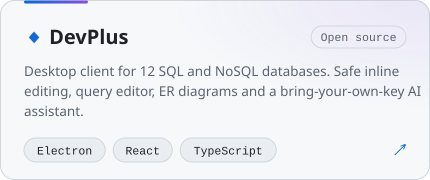
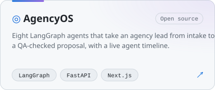
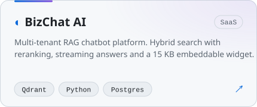
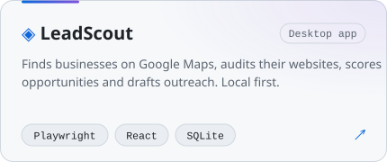

<a href="https://aashifahd.com">
  <picture>
    <source media="(prefers-color-scheme: dark)" srcset="assets/hero-dark.svg" />
    
  </picture>
</a>

 

[**Website**](https://aashifahd.com) &nbsp;·&nbsp;
[**CenoDigital**](https://cenodigital.com) &nbsp;·&nbsp;
[**LinkedIn**](https://linkedin.com/in/aashifahd) &nbsp;·&nbsp;
[**X**](https://twitter.com/aashifahd) &nbsp;·&nbsp;
[**Email**](mailto:hello@aashifahd.com)

 

I run **[CenoDigital](https://cenodigital.com)**, where I design and build products end to end: SaaS platforms, client portals, CMSs and AI features people actually use. I like owning the whole path, from the database schema to the deploy on my own servers.

- **Now** · shipping [DevPlus](https://github.com/aashifahd/devplus), an open source database client
- **Into** · multi-agent systems, RAG, local-first desktop apps
- **Ask me about** · Laravel, Next.js, FastAPI, Docker and self-hosting with Coolify

 

## Selected work

<table>
<tr>
<td width="50%">
<a href="https://github.com/aashifahd/devplus">
  <picture>
    <source media="(prefers-color-scheme: dark)" srcset="assets/devplus-dark.svg" />
    
  </picture>
</a>
</td>
<td width="50%">
<a href="https://github.com/aashifahd/agencyos">
  <picture>
    <source media="(prefers-color-scheme: dark)" srcset="assets/agencyos-dark.svg" />
    
  </picture>
</a>
</td>
</tr>
<tr>
<td width="50%">
<a href="https://cenodigital.com">
  <picture>
    <source media="(prefers-color-scheme: dark)" srcset="assets/bizchat-dark.svg" />
    
  </picture>
</a>
</td>
<td width="50%">
<a href="https://cenodigital.com">
  <picture>
    <source media="(prefers-color-scheme: dark)" srcset="assets/leadscout-dark.svg" />
    
  </picture>
</a>
</td>
</tr>
</table>

 

## Stack

<picture>
  <source media="(prefers-color-scheme: dark)" srcset="https://skillicons.dev/icons?i=ts,react,nextjs,astro,tailwind,laravel,php,python,fastapi,nodejs,electron,postgres,mysql,redis,docker,cloudflare&perline=16&theme=dark" />
  
</picture>

Also: LangChain · LangGraph · Qdrant · shadcn/ui · Payload CMS · Better Auth · Playwright · Coolify · GitHub Actions · Figma

  

## Activity

<picture>
  <source media="(prefers-color-scheme: dark)" srcset="https://github-readme-stats.vercel.app/api?username=aashifahd&show_icons=true&include_all_commits=true&hide_border=true&hide_title=true&theme=github_dark&bg_color=0d1117&icon_color=a371f7&title_color=58a6ff" />
  
</picture>
<picture>
  <source media="(prefers-color-scheme: dark)" srcset="https://streak-stats.demolab.com?user=aashifahd&hide_border=true&background=0d1117&ring=a371f7&fire=a371f7&currStreakLabel=58a6ff&currStreakNum=e6edf3&sideNums=e6edf3&sideLabels=8b949e&dates=8b949e&stroke=30363d" />
  
</picture>

  

<picture>
  <source media="(prefers-color-scheme: dark)" srcset="https://raw.githubusercontent.com/aashifahd/aashifahd/refs/heads/output/snake-dark.svg" />
  
</picture>

 

**Have a project in mind?** &nbsp;[hello@aashifahd.com](mailto:hello@aashifahd.com)

