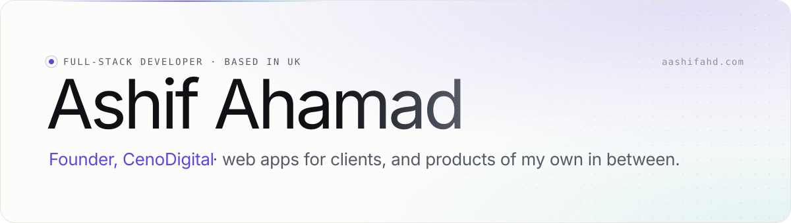
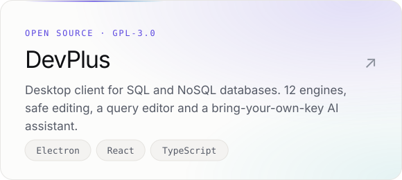
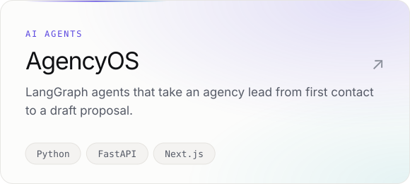
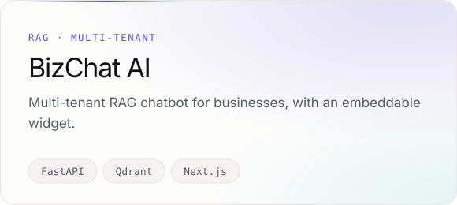
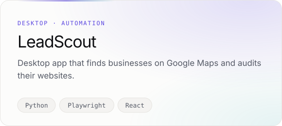

<a href="https://aashifahd.com">
  <picture>
    <source media="(prefers-color-scheme: dark)" srcset="assets/header-dark.svg" />
    
  </picture>
</a>

 

I'm a full-stack developer from Sri Lanka, now based in the UK. I run **[CenoDigital](https://cenodigital.com)**, where we design and build web apps for clients, and in between I ship products of my own: desktop tools, AI agents and SaaS.

 

### Building

  <a href="https://github.com/aashifahd/devplus"><picture><source media="(prefers-color-scheme: dark)" srcset="assets/card-devplus-dark.svg" /></picture></a>
  <a href="https://github.com/aashifahd/agencyos"><picture><source media="(prefers-color-scheme: dark)" srcset="assets/card-agencyos-dark.svg" /></picture></a>
  <picture><source media="(prefers-color-scheme: dark)" srcset="assets/card-bizchat-dark.svg" /></picture>
  <picture><source media="(prefers-color-scheme: dark)" srcset="assets/card-leadscout-dark.svg" /></picture>

  
  
  
  

 

### Currently

- **DevPlus.** Shipping an open source database client for 12 engines, from Postgres and MySQL to MongoDB, Redis, ClickHouse and DuckDB, with installers for Windows, macOS and Linux.
- **CenoDigital.** Leading client builds and mentoring a team of developer interns through branch, PR and review workflows.
- **AI agents.** Exploring LangGraph workflows and retrieval (RAG) with AgencyOS and BizChat AI.

 

### Stack

<table>
  <tr>
    <td width="140"><b>FRONTEND</b></td>
    <td><picture><source media="(prefers-color-scheme: dark)" srcset="https://skillicons.dev/icons?i=ts%2Creact%2Cnextjs%2Ctailwind&theme=dark" /></picture></td>
  </tr>
  <tr>
    <td><b>BACKEND</b></td>
    <td><picture><source media="(prefers-color-scheme: dark)" srcset="https://skillicons.dev/icons?i=php%2Claravel%2Cpython%2Cfastapi&theme=dark" /></picture></td>
  </tr>
  <tr>
    <td><b>DESKTOP</b></td>
    <td><picture><source media="(prefers-color-scheme: dark)" srcset="https://skillicons.dev/icons?i=electron&theme=dark" /></picture></td>
  </tr>
  <tr>
    <td><b>DATA</b></td>
    <td><picture><source media="(prefers-color-scheme: dark)" srcset="https://skillicons.dev/icons?i=postgres%2Cmysql%2Credis&theme=dark" /></picture></td>
  </tr>
  <tr>
    <td><b>INFRA</b></td>
    <td><picture><source media="(prefers-color-scheme: dark)" srcset="https://skillicons.dev/icons?i=docker%2Ccloudflare&theme=dark" /></picture></td>
  </tr>
  <tr>
    <td><b>AI &amp; AUTOMATION</b></td>
    <td><code>LangGraph</code>&nbsp; <code>RAG</code>&nbsp; <code>Qdrant</code>&nbsp; <code>Playwright</code></td>
  </tr>
</table>

 

### Activity

<picture>
  <source media="(prefers-color-scheme: dark)" srcset="https://streak-stats.demolab.com/?user=aashifahd&disable_animations=true&background=0A0B0F&border=1E2230&border_radius=18&card_width=1200&card_height=220&ring=8B7CFF&fire=8B7CFF&currStreakNum=F4F4F6&currStreakLabel=8B7CFF&sideNums=F4F4F6&sideLabels=A3A7B3&dates=6B7080&stroke=1E2230" />
  
</picture>

  

### Say hi

  
  
  
  
  

